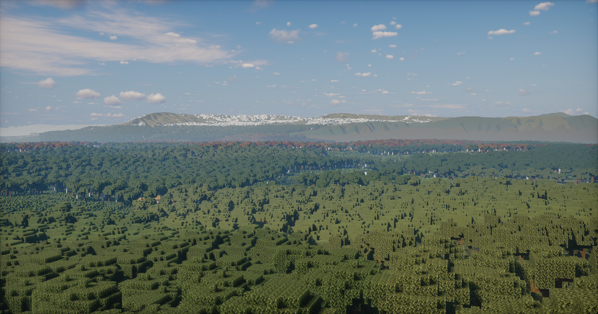
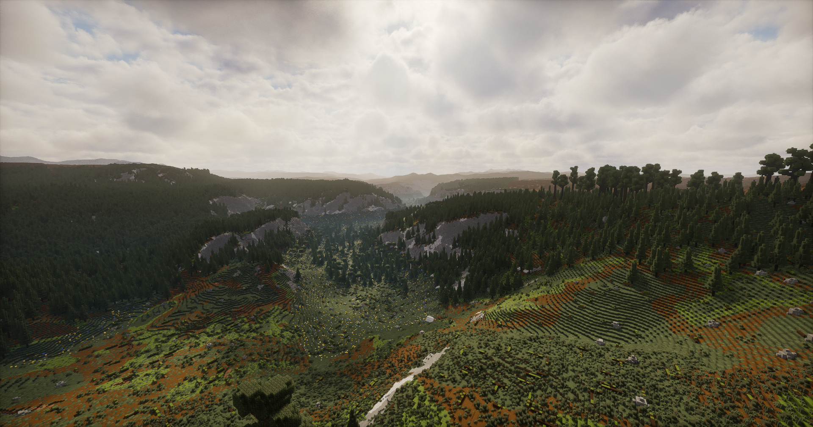
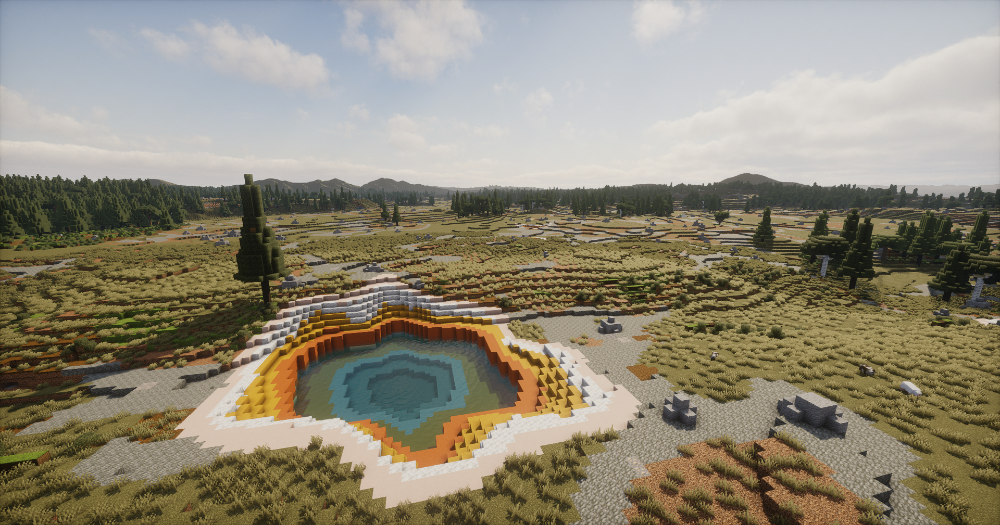
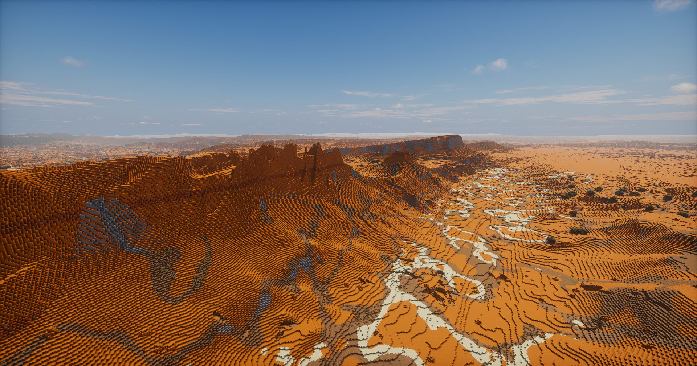
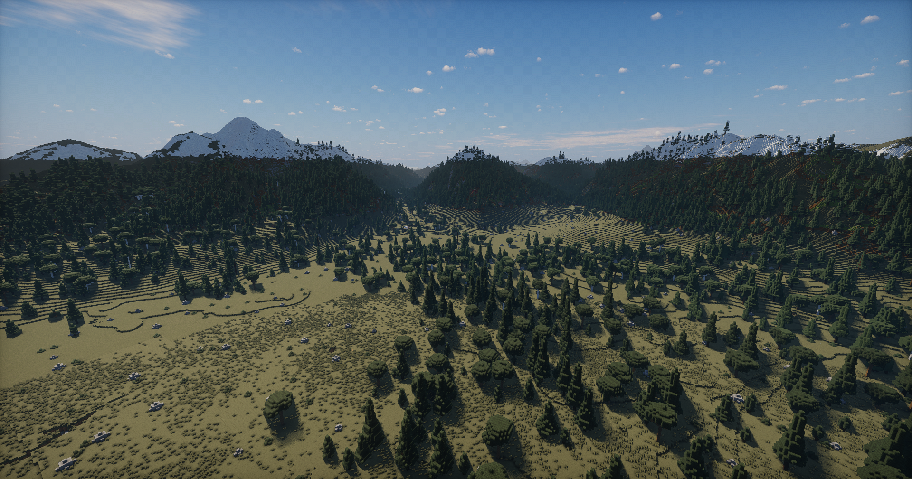

# Wild Vibes

A vibe-coded Minecraft terrain generation mod inspired by the national parks of the United States.

Wild Vibes brings park-inspired landscapes, biomes, and vegetation into procedurally generated Minecraft worlds. Its terrain draws inspiration from real geology and ecosystems, with some park generators incorporating USGS elevation samples. These are stylized worlds, not exact geographic recreations.

## Features

- **Standalone parks:** Explore individual park-inspired worlds, each with its own terrain, biome mix, vegetation, and color palette. Standalone builds let each park be developed and refined on its own.
- **Distinct landscapes:** Discover forested mountains, granite valleys, snowy ridges, sandstone formations, and Yellowstone-inspired hot springs.
- **Procedural variety:** World seeds shape the landscape, with supported park generators using USGS elevation samples as references for varied terrain rather than reproducing one fixed real-world map.
- **Vegetation with variety:** Custom tree shapes and sizes, changing forest density, and groundcover help give each landscape its own character.

### The bigger goal

The overall goal is one large terrain generation mod that brings these park-inspired landscapes together in a connected Overworld. The combined world is intended to account for north–south climate differences: colder regions toward the north (-Z), warmer regions toward the south (+Z), and a broad temperate transition between them. Terrain and biomes should blend across regions to make exploration feel like a continuous world.

Development currently focuses on refining the standalone parks; the complete combined world remains a work in progress.

## Gallery

| Smokies | Yosemite |
| :---: | :---: |
|  |  |
| **Yellowstone** | **Arches** |
|  |  |
| **Grand Teton** | |
|  | |

## Credits and sources

USGS elevation data informs terrain generation and is bundled for supported parks. National Park Service materials and other published references inform landscape, geology, and vegetation details.

Reference photographs were consulted for visual inspiration and color palette analysis; the photographs themselves are not included in the mod.

Detailed references and data acknowledgments belong in `SOURCES.md`, with contributor and project acknowledgments in `CREDITS.md`. Third-party materials remain subject to their applicable terms.

## License

Wild Vibes is licensed under the GPLv3 License. See `LICENSE` for the full terms and copyright notices.

This is an independent project and is not affiliated with or endorsed by Mojang, Microsoft, the National Park Service, or the USGS.
