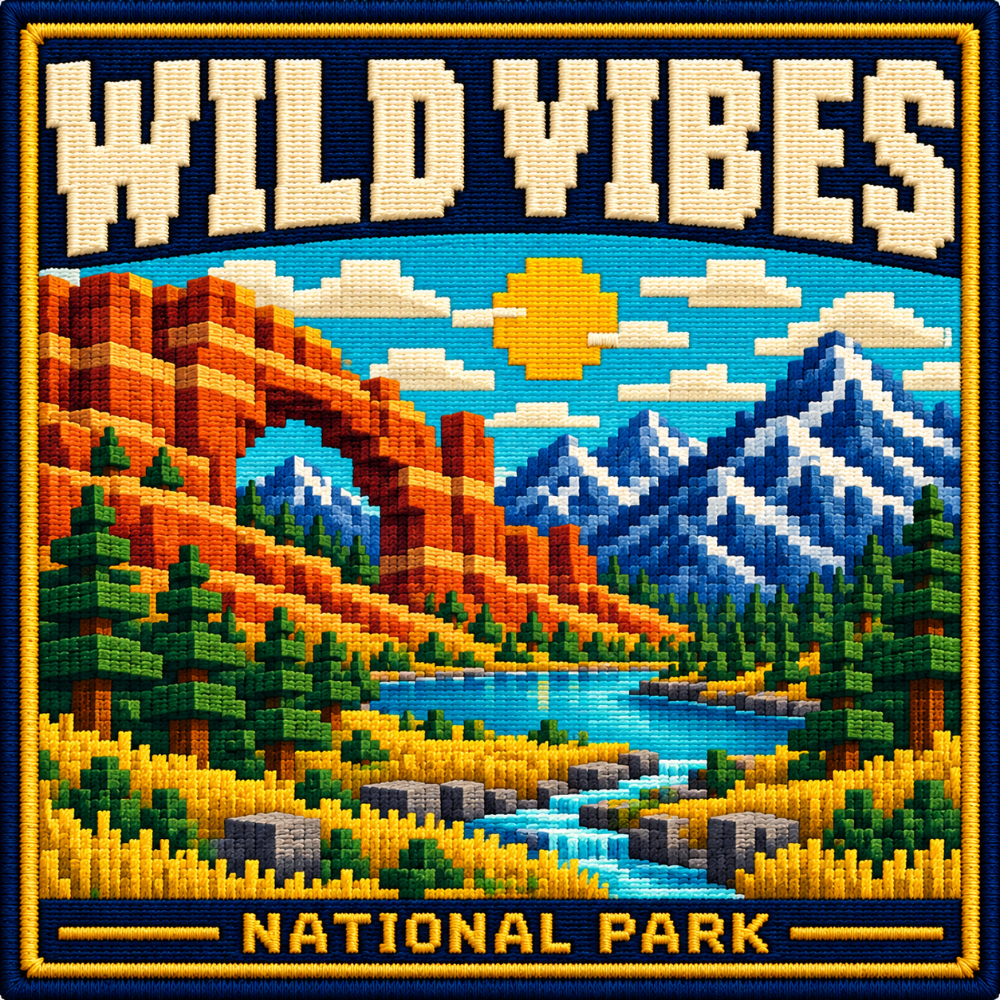
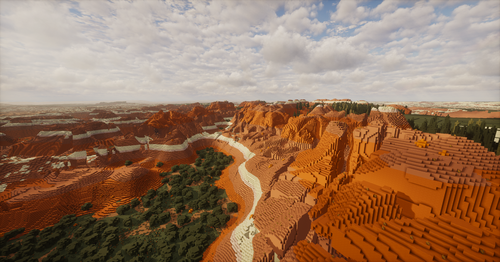
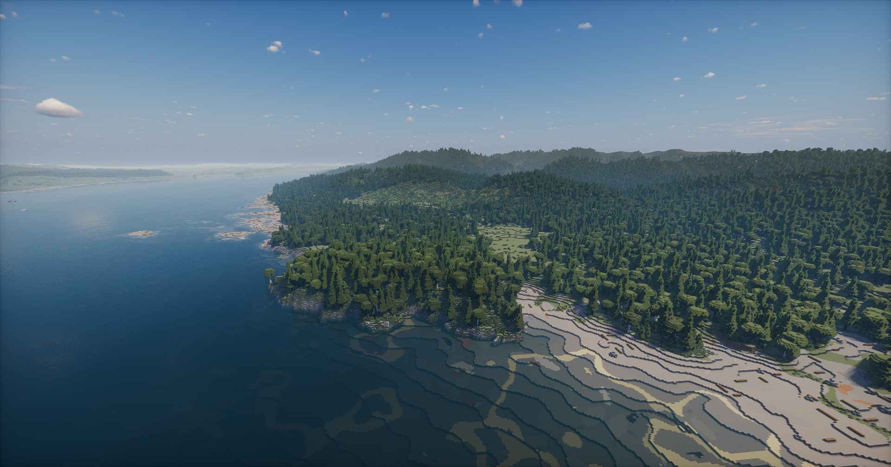
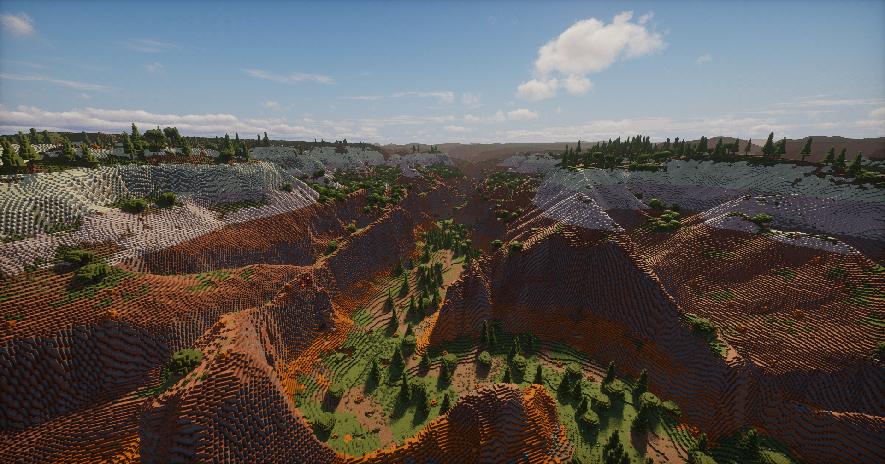

<h1 align="center">Welcome to Wild Vibes</h1>

<strong>Big landscapes. Fresh worlds. Wild adventures.</strong>

A vibe-coded Minecraft terrain generation mod inspired by the national parks of the United States.

<a href="#welcome">Welcome</a> · <a href="#explore">Explore the Parks</a> · <a href="#visit">Plan Your Visit</a> · <a href="#notes">Field Notes</a> · <a href="#credits">Credits</a>

<em>Bryce Canyon · Actual mod gameplay. All landscape images below are project screenshots.</em>

<h2 id="welcome"></h2>

Wild Vibes brings park-inspired landscapes, biomes, and vegetation into procedurally generated Minecraft worlds. Its terrain draws inspiration from real geology and ecosystems, with some park generators incorporating USGS elevation samples. These are stylized worlds, not exact geographic recreations.

<ul><li><strong>Find your park.</strong> Explore standalone worlds with their own terrain, biome mix, vegetation, and color palette.</li><li><strong>Take the scenic route.</strong> Discover forested mountains, granite valleys, snowy ridges, sandstone formations, and Yellowstone-inspired hot springs.</li><li><strong>Let the seed lead.</strong> Supported generators draw on real elevation samples to create varied terrain across world seeds.</li><li><strong>Look a little closer.</strong> Custom tree shapes and sizes, changing forest density, and groundcover give each landscape its own character.</li></ul>
<h2 id="explore"></h2>

A few views from the trail. These images show the mod in game; lighting and appearance depend on the installed shaders and resource packs.

<table>
<tr><td width="50%" align="center"><h3>Great Smoky Mountains</h3>
Wooded ridges and mountain balds.
</td><td width="50%" align="center"><h3>Yosemite</h3>
Granite valleys and forested slopes.
</td></tr>
<tr><td width="50%" align="center"><h3>Yellowstone</h3>
Open country and geothermal landscapes.
</td><td width="50%" align="center"><h3>Arches</h3>
Red-rock formations and desert views.
</td></tr>
<tr><td width="50%" align="center"><h3>Grand Teton</h3>
Alpine peaks and mountain valleys.
</td><td width="50%" align="center"><h3>Olympic</h3>
Pacific Northwest forests and rugged terrain.
</td></tr>
<tr><td width="50%" align="center"><h3>Bryce Canyon</h3>
Colorful rock formations and high-country scenery.
</td><td width="50%" align="center"><h3>Zion</h3>
Towering sandstone and canyon country.
</td></tr>
</table>
<h2 id="visit"></h2>

<strong>Start with a standalone park and a fresh world.</strong> Development currently focuses on refining the individual parks.

<ol><li>Choose the standalone park build you want to explore.</li><li>Follow the requirements and installation instructions supplied with that release. Enable only one Wild Vibes build at a time.</li><li>Create a fresh world and choose the named Wild Vibes park preset.</li><li>Use that build’s README for suggested seeds and test locations.</li></ol>

<strong>Returning visitors:</strong> current standalone builds use the <code>wildvibes</code> namespace. Worlds made with older identifiers require their original mod files; existing saves are not converted automatically.

<h2 id="notes"></h2>
<h3>A bigger wilderness is taking shape</h3>

The overall goal is one large terrain generation mod that brings these park-inspired landscapes together in a connected Overworld. The combined world is intended to account for north–south climate differences: colder regions toward the north (−Z), warmer regions toward the south (+Z), and a broad temperate transition between them. Terrain and biomes should blend across regions to make exploration feel like a continuous world.

Standalone builds let each park be developed and refined on its own. The complete combined world remains a work in progress.

<h2 id="credits"></h2>

USGS elevation data informs terrain generation and is bundled for supported parks. National Park Service materials and other published references inform landscape, geology, and vegetation details.

Reference photographs were consulted for visual inspiration and color palette analysis; the photographs themselves are not included in the mod.

Detailed references and data acknowledgments belong in <code>SOURCES.md</code>, with contributor and project acknowledgments in <code>CREDITS.md</code>. Third-party materials remain subject to their applicable terms.

<h3>License</h3>

Wild Vibes is licensed under the GPLv3 License. See <code>LICENSE</code> for the full terms and copyright notices.

<em>This is an independent project and is not affiliated with or endorsed by Mojang, Microsoft, the National Park Service, or the USGS.</em>

<strong>Leave the ordinary behind. Find your Wild Vibes.</strong>

